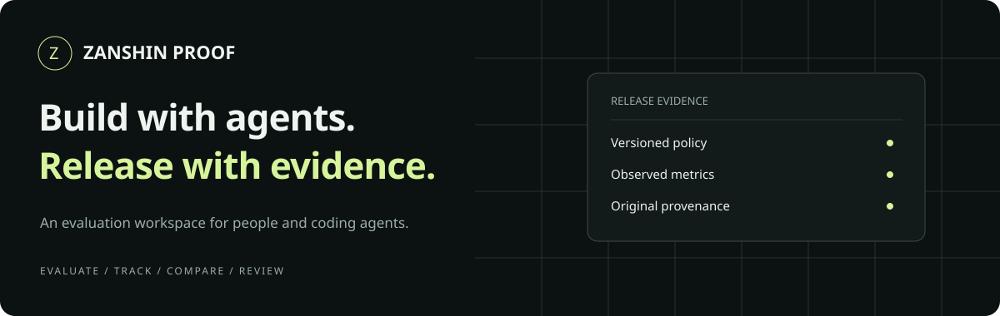

<p align="center"></p>

# Zanshin Proof

**An evaluation workspace for people and coding agents.**

[Quickstart](#try-the-workspace) · [Workspace guide](docs/agent-workspace.md) ·
[Agent onboarding](.agents-onboarding/index.md) · [Architecture](docs/architecture.md)

Evaluate a model, save the evidence, compare runs, and review what meets your release policy.
Proof brings persistent evaluation history and a portable visual workspace to its deterministic
release gates. Every saved run links the policy, metrics, model version, code, and source provenance.

| Evaluate | Track & compare | Review |
| --- | --- | --- |
| Compute metrics or bring existing evidence; apply explicit YAML policies. | Save runs from people or agents, follow parent runs, and inspect metric deltas. | Open a local browser workspace with checks, policy snapshots, provenance, and report downloads. |

## Try the workspace

Requires [uv](https://docs.astral.sh/uv/) and Python 3.11 or newer.

```bash
git clone https://github.com/zanshin-ai/zanshin-proof.git
cd zanshin-proof
uv sync --extra dev --locked
uv run python examples/workspace/make_demo.py
```

Open `proof-workspace.html`. The demo records three **synthetic** evaluations, including a blocked
regression, in `.proof/demo.db`. It demonstrates tracking and review; it runs no model training.

For your own evidence:

```bash
uv run zanshin-proof evaluate \
  --policy examples/recommendation/policy.yml \
  --evidence examples/recommendation/evidence.json \
  --store .proof/runs.db --actor agent:codex

uv run zanshin-proof runs list
uv run zanshin-proof workspace
```

Use `runs show RUN_ID`, `runs compare BASELINE_ID CANDIDATE_ID`, and `evaluate --parent RUN_ID`
to inspect and link runs. Read the [workspace guide](docs/agent-workspace.md) for exact commands,
storage and export details, trust boundaries, and the lifecycle roadmap.

## Start with your coding agent

Paste this into your coding assistant:

```text
Read https://raw.githubusercontent.com/zanshin-ai/zanshin-proof/main/.agents-onboarding/index.md
and help me evaluate my model, track its evidence, and compare it with a baseline.
```

The working product covers evaluation, local run history, comparison, and review. Training
orchestration, a hosted multi-user app, model deployment, and production monitoring remain
planned capabilities. Actor labels are self-reported; a passing gate is not human approval.

## Evidence gates for calibrated AI decisions

Zanshin Proof helps teams evaluate and release probabilistic decision systems, including
models trained with Reinforcement Learning for Calibrated Decisions (RLCD). It checks
observed facts and metrics against an explicit release policy. It gives
humans a compact evidence packet and gives CI a deterministic decision: pass, warn, or block.
Agents can help create code and collect evidence, but they do not approve their own work.

## Where Proof fits

Use Proof to gate a classifier, model router, or agent decision layer on evidence of
calibration, decision quality, automation coverage, and latency. Models supply predictions;
collectors supply observed labels; Proof computes metrics and applies explicit policy.

Proof is an evaluation and release-gating tool for RLCD-based systems. It does not train
RLCD models or provide a live Jev integration. Binary labeled outputs can be evaluated
directly; precomputed ML evidence is also supported.
Existing ML release policies remain supported.

See [Proof for calibrated decisions](docs/calibrated-decisions.md) for the evidence contract,
Jev and LangChain context, limitations, and integration roadmap.

## First working slice

The repository currently supports:

- Versioned YAML release policies
- Required and optional checks
- Boolean assertions, regression tolerances, and numeric thresholds
- Binary decision metrics: Brier score, top-label ECE, accuracy, selective error, coverage
- Optional paired baseline metrics, latency p95, and inspectable calibration bins
- Machine-readable JSON reports
- CI-safe exit codes
- A calibrated-decision policy with a runnable, explicitly synthetic demonstration
- A recommendation-model example
- Draft 2020-12 JSON Schemas for policies, evidence, and reports
- Required provenance binding evidence to code, model, run, source, and collection time
- Persistent SQLite evaluation history with actor labels, parent runs, and snapshot digests
- JSON run inspection and metric comparisons that flag changed policies
- A self-contained HTML workspace with search, filters, evidence review, and report downloads

## Try it: evaluate decision outputs

Requires [uv](https://docs.astral.sh/uv/) and Python 3.11 or newer. From a terminal:

```bash
git clone https://github.com/zanshin-ai/zanshin-proof.git
cd zanshin-proof
uv sync --extra dev --locked

uv run python examples/calibrated-decisions/make_demo.py --decisions > /tmp/decisions.json
uv run zanshin-proof evaluate \
  --policy examples/calibrated-decisions/policy.yml \
  --decisions /tmp/decisions.json \
  --evidence-output /tmp/decision-evidence.json \
  --output /tmp/decision-report.json
```

Expected: `pass`, nine passing checks, exit code `0`. Proof computes metrics from 100
synthetic labeled records: accuracy `0.99`, Brier score approximately `0.0099`, ECE `0`,
coverage `1`, selective error `0.01`, and p95 latency `180` ms. These demonstrate the
calculation, not real model performance.

Follow the [working example walkthrough](docs/working-example.md) to inspect the output,
make a required gate fail, and adapt the input to your own model. The
[decision-record contract](docs/decision-records.md) defines every metric and input field.

## Evaluate precomputed evidence

From the same checkout:

```bash
uv run zanshin-proof evaluate \
  --policy examples/recommendation/policy.yml \
  --evidence examples/recommendation/evidence.json \
  --output /tmp/recommendation-report.json
```

This older example returns `warn` for catalog coverage with exit code `0`. Exit code `1`
means a required check blocks release; `2` means invalid input or an output-write error.
Use `uv run pytest`, `uv run ruff check .`, and `uv build` for verification and packaging.

## Policy example

```yaml
version: 1
project: recommendation-ranking
checks:
  - id: auc-regression
    type: metric_regression
    candidate: metrics.candidate.auc
    baseline: metrics.baseline.auc
    tolerance: 0.005

  - id: calibration-error
    type: max_value
    path: metrics.candidate.ece
    maximum: 0.03
```

## Design principles

- Explicit intent before execution
- Deterministic gates over agent self-assessment
- Independent evidence with provenance
- Required failures cannot be explained away
- Human ownership of promotion and approval
- Durable architecture documentation instead of disposable agent notes

See [docs/architecture.md](docs/architecture.md) for system boundaries and planned integrations.

## Evidence provenance

Every evidence document must identify:

- The complete Git commit SHA evaluated
- The model name and version
- The originating run system and run ID
- The collector and collection timestamp
- At least one versioned source table, dataset, file, API, or manual input

This provenance is validated before any checks run and is copied unchanged into the report. The
schemas are packaged under `src/zanshin_proof/schemas/` and enforced at runtime.

## Near-term roadmap

1. Multiclass metrics, evaluation slices, and uncertainty bounds
2. Optional Jev and LangChain evidence collectors
3. Signed evidence bundles and GitHub pull-request checks
4. MLflow and Databricks provenance collectors
5. Authenticated human approval workflow and shared review app

