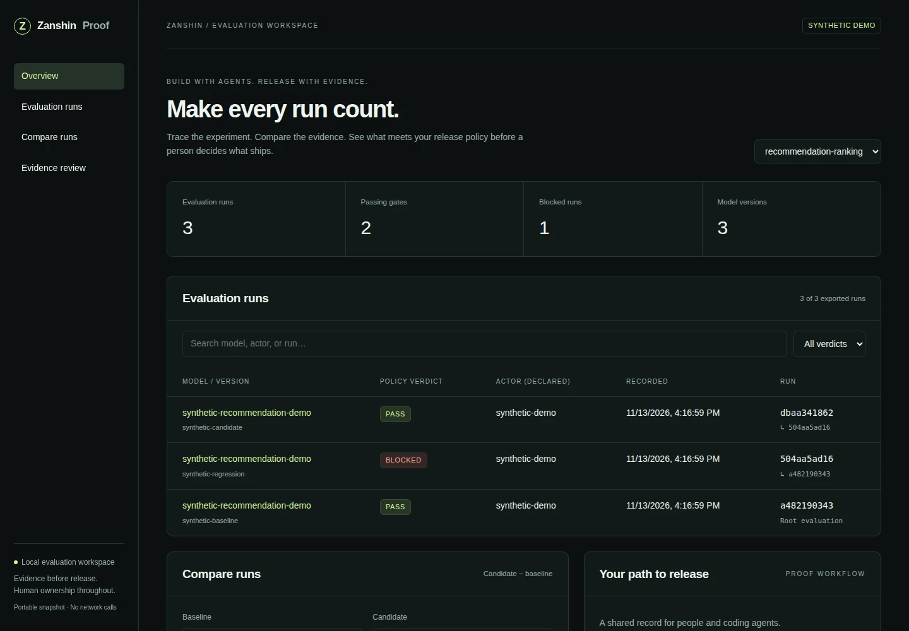
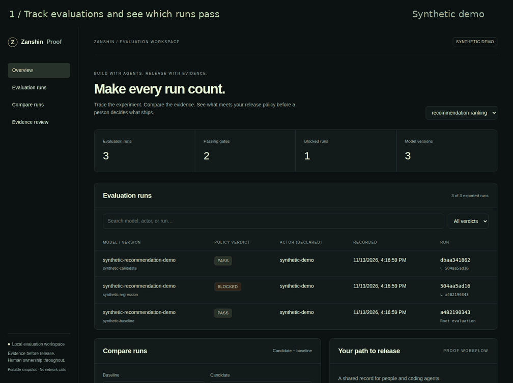
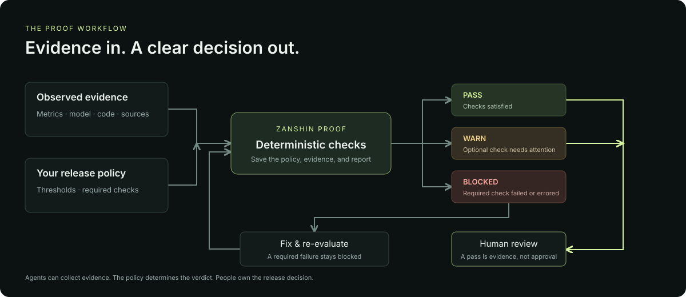

<p align="center"></p>

# Zanshin Proof

**An evaluation workspace for people and coding agents.**

[Quickstart](#try-the-workspace) · [Workspace guide](docs/agent-workspace.md) ·
[Agent onboarding](.agents-onboarding/index.md) · [Architecture](docs/architecture.md)

Evaluate a model, save the evidence, compare runs, and review what meets your release policy.
Proof brings persistent evaluation history and a portable visual workspace to its deterministic
release gates. Every saved run links the policy, metrics, model version, code, and source provenance.



*The working workspace with synthetic demo data. Track evaluations, compare candidates, and
inspect the checks behind each verdict.*

## See the workflow



**Track → compare → inspect.** This recorded sequence uses the runnable synthetic demo below.
The regression scores AUC `0.70`, below the policy floor of `0.807`, so its required check blocks
release. That floor comes from the evidence baseline (`0.812`) minus the allowed drop (`0.005`).
Comparing saved runs changes the displayed deltas; it does not re-evaluate their gates.
[Open the static workspace screenshot](docs/assets/proof-workspace.webp) if you prefer an image
without animation.

## How Proof reaches a verdict



The policy determines the verdict. People own the release decision. A passing gate supplies
evidence for review; it does not approve or deploy a model.

## Try the workspace

Requires [uv](https://docs.astral.sh/uv/) and Python 3.11 or newer. From a POSIX shell
(macOS, Linux, or WSL):

```bash
git clone https://github.com/zanshin-ai/zanshin-proof.git
cd zanshin-proof
uv sync --extra dev --locked
uv run python examples/workspace/make_demo.py
```

Open `proof-workspace.html`. The demo saves three **synthetic** evaluations, including a
blocked regression, in `.proof/demo.db`. Repeated runs append three more evaluations.
It demonstrates evaluation history and review; it performs no model training.

### Save an evaluation

After setup, evaluate the included recommendation fixture and save it in your own workspace:

```bash
uv run zanshin-proof evaluate \
  --policy examples/recommendation/policy.yml \
  --evidence examples/recommendation/evidence.json \
  --store .proof/runs.db --actor agent:codex

uv run zanshin-proof runs list
uv run zanshin-proof workspace
```

This fixture returns `warn` with exit code `0`: its optional catalog-coverage check misses
the threshold. The three-run visual demo uses different synthetic metrics. The report is JSON
on stdout; the saved workspace run ID is printed on stderr.

For a real evaluation, replace the sample policy and evidence with your own versioned policy,
measured results, independently established facts, and actual provenance. Actor labels are
self-reported attribution. The [workspace guide](docs/agent-workspace.md) covers run IDs,
parent runs, comparison, database paths, and export limits.

## Choose your input

| Input | What Proof does | Contract |
| --- | --- | --- |
| `evaluate --evidence evidence.json` | Validate supplied facts, metrics, and provenance; apply the policy. | [Evidence v1 schema](src/zanshin_proof/schemas/evidence.schema.json) |
| `evaluate --decisions decisions.json` | Compute metrics from labeled binary outputs, then apply the policy. | [Decision records and metric definitions](docs/decision-records.md) |

Use exactly one input option. For labeled binary records, Proof computes accuracy, binary Brier
score, top-label ECE and bins, automation coverage, and selective error. Paired baseline
probabilities and candidate latency are optional inputs; a policy can require their resulting
metrics. Precomputed evidence can carry other numeric metrics, including AUC.

To try the labeled-record path after setup:

```bash
uv run python examples/calibrated-decisions/make_demo.py --decisions > /tmp/decisions.json
uv run zanshin-proof evaluate \
  --policy examples/calibrated-decisions/policy.yml \
  --decisions /tmp/decisions.json \
  --evidence-output /tmp/decision-evidence.json \
  --output /tmp/decision-report.json
```

Expected: `pass`, nine passing checks, exit code `0`. The records are synthetic.
Follow the [working example](docs/working-example.md) to inspect the metrics, produce a blocked
variant, and adapt the input to your model.

## Policy example

This is the complete [recommendation policy](examples/recommendation/policy.yml) used by the
workspace demo. Thresholds illustrate the mechanics; choose values appropriate to your model
and evaluation set.

```yaml
version: 1
project: recommendation-ranking

# Illustrative thresholds, not production defaults. Required failures block release.
checks:
  - id: schema-compatible
    type: boolean
    required: true
    description: Candidate features remain compatible with serving.
    path: facts.schema_compatible

  - id: reproducible-training
    type: boolean
    required: true
    description: The candidate can be reproduced from pinned inputs.
    path: facts.reproducible_training

  - id: auc-regression
    type: metric_regression
    required: true
    description: AUC cannot fall more than five thousandths below baseline.
    candidate: metrics.candidate.auc
    baseline: metrics.baseline.auc
    tolerance: 0.005

  - id: calibration-error
    type: max_value
    required: true
    description: Expected calibration error must remain below the release threshold.
    path: metrics.candidate.ece
    maximum: 0.03

  - id: catalog-coverage
    type: min_value
    required: false
    description: A coverage miss should be visible but does not yet block release.
    path: metrics.candidate.catalog_coverage
    minimum: 0.65
```

Required failures or missing required metrics block release. Optional failures produce warnings.
`required` defaults to `true`; it is explicit here so the difference is visible.
The regression check requires `candidate >= baseline - tolerance`; use `max_value` for an
upper-bound metric such as latency. Boolean checks inspect supplied facts; they do not independently
verify feature compatibility or reproduce training.

## Verdicts and exit codes

| Evaluation result | Meaning | Exit code |
| --- | --- | --- |
| `pass` | All checks passed. | `0` |
| `warn` | Required checks passed; an optional check failed or errored. | `0` |
| `fail` (shown as **Blocked** in the workspace) | A required check failed or errored. | `1` |
| Configuration or operation error | Invalid input or an operation such as saving output failed. | `2` |

Read and export commands return `0` when the operation succeeds, even if a saved run is blocked.
Use the report's verdict or the exit code from `evaluate` for gating. A passing gate is evidence
for a human-owned release process.

## Commands

| Command after `uv run zanshin-proof` | Purpose |
| --- | --- |
| `evaluate` | Apply a policy; optionally save the evaluation with `--store`. |
| `runs list` | List saved run summaries; filter by `--project` or bound results with `--limit`. |
| `runs show RUN_ID` | Inspect the full policy, evidence, report, and provenance snapshot. |
| `runs compare BASELINE_ID CANDIDATE_ID` | Show numeric deltas for same-project runs and flag changed policies. |
| `workspace` | Export a self-contained HTML review workspace. |

Read/export commands default to `.proof/runs.db`. Run IDs refer to workspace evaluations, not
the originating training system's IDs. Use `--help` on any command for its exact options.
The HTML is an offline snapshot; re-export to include new runs.

## Start with your coding agent

Paste this into your coding assistant:

```text
Read https://raw.githubusercontent.com/zanshin-ai/zanshin-proof/main/.agents-onboarding/index.md
and help me evaluate my model, track its evidence, and compare it with a baseline.
```

Agents use the same CLI and deterministic policy engine. They can collect evidence and inspect
results; an actor label or a model's claim of success does not approve a release.

## Evidence and trust

Every evidence document must identify a full Git commit SHA, model name and version, originating
run, collector, collection timestamp, and at least one versioned source. Reports preserve the
supplied provenance. Packaged JSON Schemas enforce its presence and shape, not its authenticity.

Saved runs contain normalized policy, evidence, and report snapshots with SHA-256 digests.
These local hashes detect accidental changes; they are not signatures. Exported HTML embeds
full evidence and provenance. Review its contents before sharing.

## Current scope and planned capabilities

Proof currently provides deterministic evaluation, binary metric computation, local SQLite
history, JSON run comparison, and offline visual review. Training orchestration, model
deployment, production monitoring, multiclass scoring, live provider collectors, authenticated
actors, and approval enforcement are not implemented.

See the [capability roadmap](docs/agent-workspace.md#product-direction) for planned extensions
and the [architecture](docs/architecture.md) for system boundaries.

## Development

After setup:

```bash
uv run pytest
uv run ruff check .
uv build
```

CI checks tests, lint, package builds, packaged HTML, and runnable examples. The separate
README-visuals workflow captures the real synthetic demo and checks desktop and phone layouts.

## Documentation

| Guide | Use it for |
| --- | --- |
| [Workspace guide](docs/agent-workspace.md) | Persistence, lineage, comparison, exports, and current limits. |
| [Working example](docs/working-example.md) | A complete labeled-decision walkthrough, including a blocked variant. |
| [Decision records](docs/decision-records.md) | Input fields and exact metric definitions. |
| [Calibrated decisions](docs/calibrated-decisions.md) | Calibration and decision-routing use cases, including RLCD context. |
| [Architecture](docs/architecture.md) | Evaluation boundaries, provenance, and planned integration seams. |
| [Visual assets](docs/assets/README.md) | Reproduce the README screenshot and animation. |

